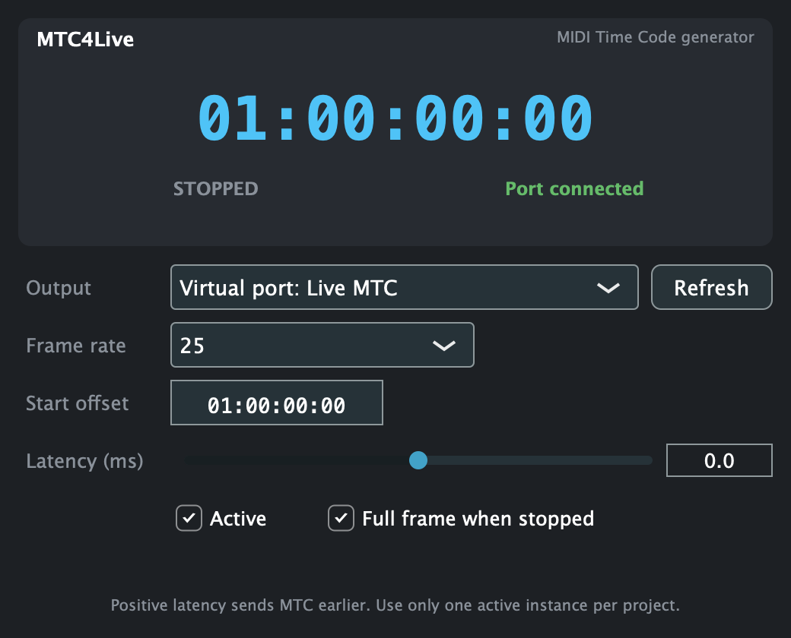

<div align="center">

# MTC4Live

**MIDI Time Code generator for Ableton Live**

Live plays, MTC4Live sends timecode, everything else follows.




</div>

## Features

- **Follows Live's transport.** Play, stop, locate and loop are sent to the receiver as MTC.
- **Built-in virtual MIDI port.** "Live MTC" shows up in every app, so no IAC setup is needed. Hardware ports work too.
- **All common frame rates:** 24, 25, 29.97 drop-frame and 30.
- **Precise timing.** Messages are timestamped and delivered by CoreMIDI, with sub-millisecond jitter.
- **Start offset and latency trim** to line the receiver up with what you hear.
- **Audio passes through untouched.** Settings are saved with your Live set.

## Quick start

1. Put **MTC4Live** on any audio track (an empty one is fine).
2. In the receiving app (Reaper, Logic, QLab, a lighting desk…), choose **Live MTC** as the MTC input and set the same frame rate.
3. Press play in Live.

> Use one active MTC4Live instance per project.

## Build

Needs CMake and [JUCE 8](https://juce.com). By default the build looks for JUCE in `~/JUCE/JUCE`; to use another location, pass `-DJUCE_PATH=…`.

```bash
cmake -S . -B build -DCMAKE_BUILD_TYPE=Release "-DCMAKE_OSX_ARCHITECTURES=arm64;x86_64"
cmake --build build -j8
```

The plugin is installed to `~/Library/Audio/Plug-Ins` automatically. In Live, Option-click **Rescan**. For signing and distribution, see [`deployment.md`](deployment.md).

## Testing

```bash
ctest --test-dir build                                    # unit tests (+ ASan/UBSan)
./build/MTC4LiveTool_artefacts/Release/MTC4LiveTool e2e      # end-to-end MTC test
./build/MTC4LiveTool_artefacts/Release/MTC4LiveTool monitor  # live MTC reader for "Live MTC"
```
